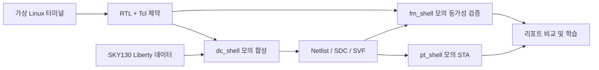

# DC Shell Sim

**반도체 설계 흐름을 로컬 터미널에서 연습하는 Python 기반 EDA 학습 환경**


가상 Linux 셸에서 RTL을 읽고, 제약을 설정하고, 합성·타이밍·등가성 리포트를 확인하는 과정을 연습합니다. 별도 상용 EDA 도구 설치 없이 명령과 산출물의 관계를 익히도록 구현했습니다.

> **학습용 모의 도구입니다.** Synopsys 제품이 아니며 해당 회사와 제휴하지 않습니다. 실제 논리 합성, sign-off STA, formal equivalence verification을 수행하지 않습니다. 리포트 수치는 설계 검증이나 제조 판단에 사용할 수 없습니다.

## 프로젝트에서 보여주는 구현

| 영역 | 구현 내용 | 관련 코드 |
|---|---|---|
| 셸 및 파일 시스템 | 가상 경로, 파이프·리다이렉션, 환경변수, 실제 드라이브의 읽기 전용 마운트 | [vterm.py](vterm.py) |
| EDA 명령 해석 | Tcl 스타일 명령·변수·collection, RTL 구조 분석, 제약과 옵션에 따른 모의 리포트 | [dc_shell_sim.py](dc_shell_sim.py) |
| Liberty 데이터 처리 | `.lib` 파싱, 셀 기능의 진리표 분류, NLDM 테이블 보간 | [libparse.py](libparse.py) |
| 도구 간 상태 연결 | netlist의 `SIMMETA`로 디자인 복원, RTL 해시 비교를 활용한 모의 등가성 판정 | [eda_tools.py](eda_tools.py) |
| 터미널 사용성 | 명령·경로·옵션 자동완성, 히스토리 검색, 줄 편집 | [lineedit.py](lineedit.py) |

## 실습 흐름



## 빠른 시작

Python 3.8 이상이 필요하며 `pip install` 단계는 없습니다. Windows에서는 `run_dc_shell.bat`으로도 실행할 수 있습니다.

```bash
git clone https://github.com/Jungwoo-Choi-21332/dc_shell_sim.git
cd dc_shell_sim
python dc_shell_sim.py
```

프로그램이 연 가상 Linux 터미널 안에서 다음을 입력합니다. 최초 실행 시 `home/`과 데모 RTL·Tcl 파일이 자동 생성됩니다.

```bash
cd ~/projects/sky130_demo
dc_shell -f scripts/run_dc.tcl | tee dc.log
pt_shell -f scripts/run_pt.tcl | tee pt.log
fm_shell -f scripts/run_fm.tcl | tee fm.log
ls outputs reports
cat reports/timing.rpt
```

실제 운영체제에서는 `python dc_shell_sim.py`로 터미널을 열고, `-f` 등 EDA 실행 옵션은 그 안의 `dc_shell` 명령에 전달합니다. 종료할 때는 EDA 셸과 가상 Linux 셸에서 각각 `exit`를 입력합니다.

## 데모 결과: 코너에 따른 차이

```bash
dc_shell -f scripts/run_corners.tcl
grep -H "Critical Path Slack" reports/qor_*.rpt
```

동봉된 `sky130_demo`, 10 ns 클럭 기준으로 직접 실행해 확인한 **시뮬레이터 출력**입니다. 셀 데이터는 Liberty에서 읽지만 연결 구조와 전체 설계 결과는 추정 모델입니다.

| 코너 | 동작 조건 | 모의 cell area | 모의 critical path slack |
|---|---|---:|---:|
| tt | 25°C / 1.80 V | 14012.188800 | +4.54 ns |
| ss | −40°C / 1.40 V | 16772.336000 | −0.88 ns |
| ff | −40°C / 1.95 V | 13305.260800 | +5.35 ns |

일반 데모에서는 `check_timing succeeded.`와 `Verification SUCCEEDED`를 확인할 수 있습니다. RTL을 변경하고 재합성하지 않으면 모의 FM이 변경을 탐지하는 실습도 가능합니다. [실행 기록](docs/demo-session.txt) · [검증 범위](docs/VALIDATION.md)

## 설계 판단과 한계

- **표준 라이브러리만 사용:** 설치 부담을 줄이고 명령행 환경에서 실습할 수 있도록 구성했습니다.
- **실제 셀 데이터 + 추정 설계 모델:** 공개 SKY130의 면적·핀·NLDM 데이터를 읽되, 실제 합성 엔진 없이 RTL 통계에 따라 netlist와 리포트를 생성합니다.
- **모의 도구 간 연계:** DC 산출물에 시뮬레이터 메타데이터를 넣어 PT/FM 실습으로 연결합니다. 외부 도구와의 포맷 호환성을 보장하지 않습니다.
- **파일 쓰기 경계:** 외부 마운트는 읽기 전용으로 처리합니다. 보안 격리용 샌드박스를 제공하는 프로그램은 아닙니다.
- **해석 범위:** Linux/Bash와 Tcl/Verilog의 일부를 구현하며 전체 언어와 상용 도구 명령을 지원하지 않습니다. VCS나 실제 HDL 시뮬레이션은 지원하지 않습니다.
- **확장 과제:** 명령 호환성 확대, 모듈 분리, 자동 검증 범위 확대는 향후 개선 방향입니다.

## 저장소 안내

```text
dc_shell_sim.py       EDA 명령 및 모의 합성 엔진 / 프로그램 진입점
vterm.py             가상 Linux 셸, 파일 시스템, 데모 템플릿
eda_tools.py         모의 PrimeTime / Formality
libparse.py          Liberty 파서와 셀 분류·보간
lineedit.py          자동완성 및 줄 편집
libs/                공개 SKY130 데이터, 출처 및 Apache-2.0 고지
docs/                사용 설명서, 설계 문서, 검증 및 실행 기록
tests/               임시 작업 공간을 사용하는 회귀 검증
```

기존 실습 이력·개인 RTL·마운트 설정·생성 파일은 포함하지 않았습니다. [상세 사용 설명서](docs/USAGE.ko.md) · [구조 설명](docs/ARCHITECTURE.md) · [라이브러리 추가 방법](libs/README.md)

## 검증 실행

```bash
python -m unittest discover -s tests -v
```

## 저작권 및 외부 자료

작성자: [Jungwoo Choi](https://github.com/Jungwoo-Choi-21332)

동봉 SKY130 데이터는 [별도 Apache-2.0 라이선스](libs/sky130_fd_sc_hd/LICENSE)와 [출처·수정 고지](libs/sky130_fd_sc_hd/NOTICE.md)를 따릅니다. 이 저장소는 작성한 프로그램 코드에 대한 별도 오픈소스 라이선스를 부여하지 않습니다. 상표와 제품명은 각 소유자에게 속합니다.
